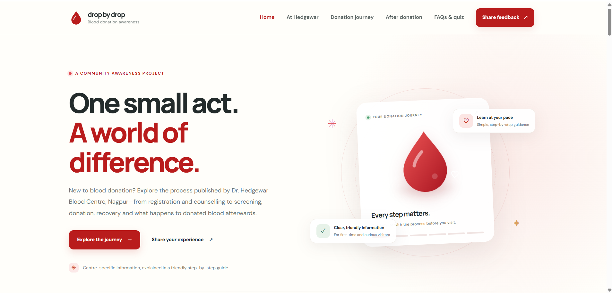
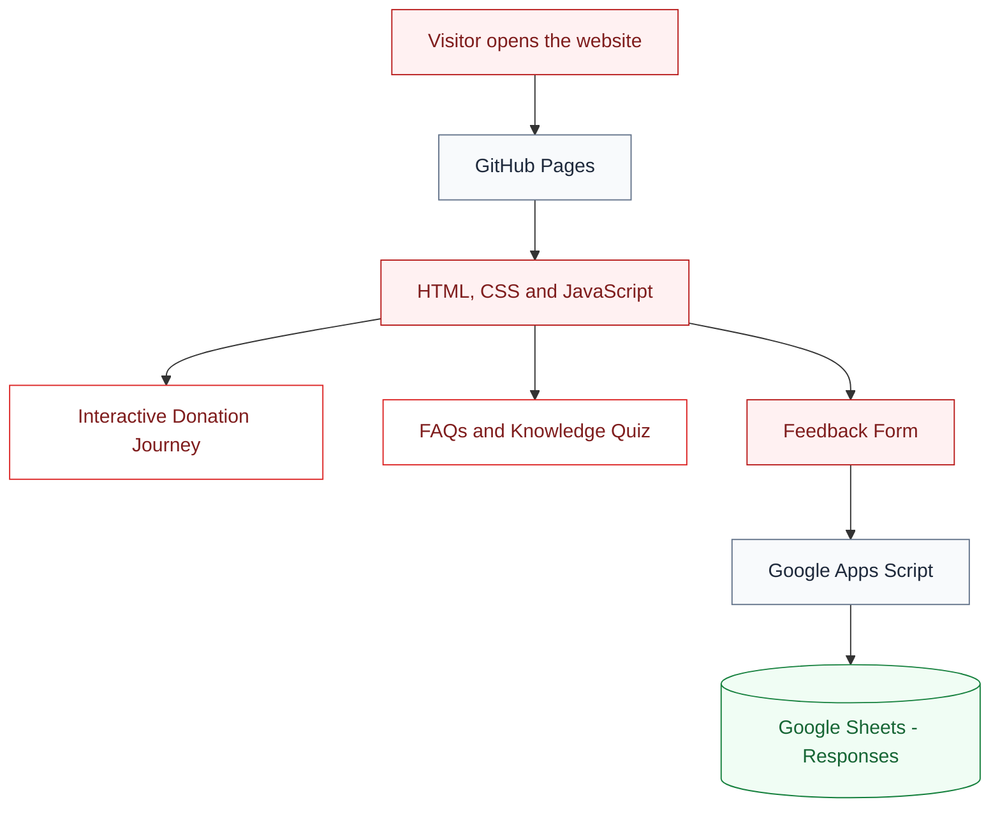

# 🩸 Drop by Drop

### Understand the journey. Spread awareness. Make information accessible.

An interactive blood donation awareness website developed as a
Community Engagement Project, based on publicly available information
from Dr. Hedgewar Blood Centre, Nagpur.

---

---

## 👀 Website Preview

Take a look at Drop by Drop in action.

🌐 **[Visit the Live Website →](https://01patilA04.github.io/blood-donation-cep/)**

---

---

## ⚙️ How It Works

Drop by Drop combines an interactive website with a cloud-based feedback system.

### The process in simple terms

- **GitHub Pages** delivers your website to visitors.
- **HTML, CSS and JavaScript** create the interface and its interactive features.
- **Google Apps Script** processes feedback submissions.
- **Google Sheets** stores the submitted responses for your team to review.

---

## 🌱 Why Drop by Drop?

For first-time donors, understanding the blood donation process can
feel unfamiliar. Drop by Drop presents the journey in a simple,
interactive format so visitors can explore each stage, learn through
FAQs and a short quiz, and share feedback about their experience.

**Our goal:** Make reliable blood donation information easier to explore.

# Drop by Drop — Blood Donation Journey (CEP website)

A responsive, front-end student project for blood donation awareness, customised around the public information published by Dr. Hedgewar Blood Centre, Nagpur.

## Features

- Responsive landing page and navigation
- Hedgewar Blood Centre profile with official links and publicly listed contact information
- Six-stage interactive donor journey: before the visit, registration and counselling, health screening, donation, refreshment and recovery, aftercare
- Additional information on published aftercare guidance, the screening tests mentioned in donor consent, and blood components/services listed by the centre
- Seven expandable, centre-specific FAQs
- Six-question quiz with instant explanations and a score
- Feedback and experience form (browser-only demo mode)

## Run the website

1. Download and extract the project ZIP.
2. Open the extracted `blood-donation-cep` folder in Visual Studio Code using **File → Open Folder**.
3. Open `index.html` in a browser. For convenient development, install the **Live Server** extension in VS Code and choose **Open with Live Server** when right-clicking `index.html`.
4. Test all six stages, the FAQ links, the six-question quiz and feedback form. Resize your browser to test the mobile layout.
5. An internet connection is needed for the official centre image, Google Fonts and external official links. The main HTML/CSS/JavaScript features run locally.

## Project files

- `index.html` — website structure and written content
- `css/style.css` — design, layout, animations and responsive styling
- `js/script.js` — journey navigation, quiz, mobile menu and demo feedback form
- `assets/` — reserved for approved local logos or illustrations

## Official source pages used

These pages were checked on 25 October 2026 and should be rechecked before the project is launched publicly.

- Home page and centre overview: https://www.hedgewarbloodbanknagpur.org/
- Blood Donation Process: https://www.hedgewarbloodbanknagpur.org/bloodDonationProcess.php
- Donor registration and consent: https://hedgewarbloodbanknagpur.org/regDonor.php
- Donor eligibility: https://www.hedgewarbloodbanknagpur.org/BloodDonateEligibility.php
- Contact details: https://www.hedgewarbloodbanknagpur.org/contactUs.php

The website summarises public information rather than acting as an official portal. The centre's own process page describes registration and counselling, checks of temperature/pulse/blood pressure/haemoglobin, donation, refreshments and aftercare. Donor consent lists screening tests, while the home page describes blood component services. Details can change and some public pages may be revised; ask the project guide and centre staff to check this site before public use. The website does not assess donor eligibility, provide individual medical advice, register donors, or manage donor/patient records.

## Feedback form: demo mode

The form currently uses browser `localStorage`. Responses are saved only in the same browser on the same device. They are **not** sent to the guide, the blood centre or a shared spreadsheet.

To collect real feedback without building a backend, the recommended next step is to create a Google Form with the same questions, embed it inside the feedback section and connect it to Google Sheets. Test the form with dummy responses and get approval for the questions/privacy wording before collecting visitor feedback. Do not simply remove the demo-mode notice until central storage is configured.

## Before public launch

- Ask Hedgewar Blood Centre and the project guide to review the medical wording, screening details and aftercare summary.
- Confirm the public contact details and official links.
- Do not copy donor registration fields or personal health information into this student website.
- Keep feedback anonymous unless there is a clear, approved reason to collect contact details.
- Test mobile and desktop layouts, links, keyboard controls, quiz behaviour and feedback submission.

## Suggested GitHub repository description

An interactive blood donation awareness website based on publicly available information from Dr. Hedgewar Blood Centre, Nagpur, featuring a six-stage donor journey, aftercare and blood component information, FAQs, a short quiz and visitor feedback form.

## Google Sheets feedback connection

The feedback form sends form-encoded responses to the configured Google Apps Script Web App URL in `js/script.js`. The browser uses `mode: "no-cors"`, so the website cannot read the Apps Script response. After your first test submission, open the `Responses` tab in the linked spreadsheet and confirm a new row has appeared.

Before testing, verify that the Apps Script source has your real spreadsheet ID in `SPREADSHEET_ID` (not the placeholder text), that the sheet is named exactly `Responses`, and that the latest script version is deployed. Do not collect names or private medical information.
