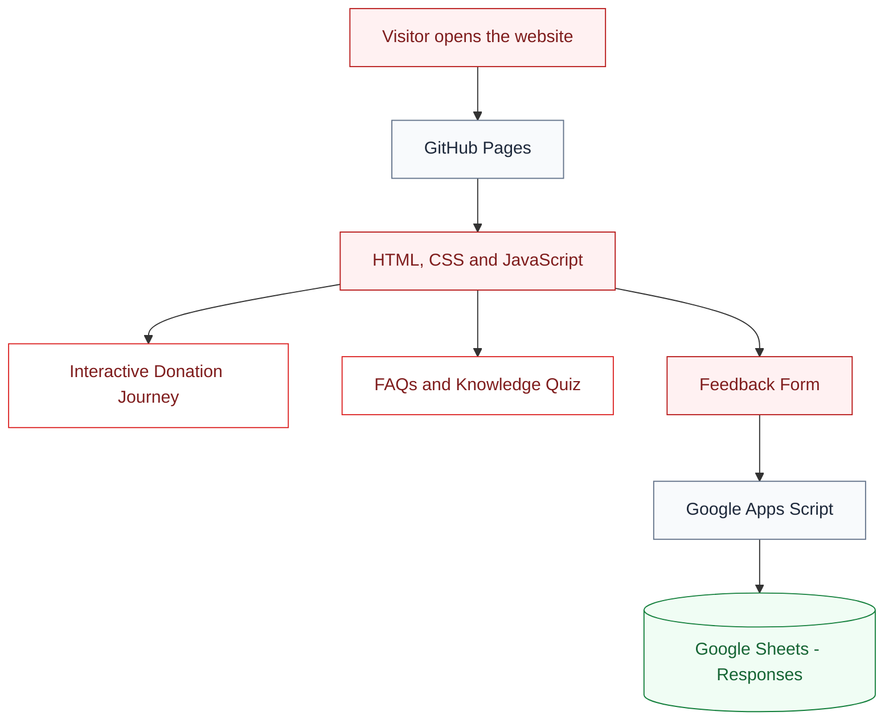

# 🩸 Drop by Drop

### Understand the journey. Spread awareness. Make information accessible.

An interactive blood donation awareness website developed as a
Community Engagement Project, based on publicly available information
from Dr. Hedgewar Blood Centre, Nagpur.

---

---

## 👀 Website Preview

Take a look at Drop by Drop in action.

🌐 **[Visit the Live Website →](https://01patilA04.github.io/blood-donation-cep/)**

---

---

## ⚙️ How It Works

Drop by Drop combines an interactive website with a cloud-based feedback system.

### The process in simple terms

- **GitHub Pages** delivers your website to visitors.
- **HTML, CSS and JavaScript** create the interface and its interactive features.
- **Google Apps Script** processes feedback submissions.
- **Google Sheets** stores the submitted responses for your team to review.

---

## 🌱 Why Drop by Drop?

For first-time donors, understanding the blood donation process can
feel unfamiliar. Drop by Drop presents the journey in a simple,
interactive format so visitors can explore each stage, learn through
FAQs and a short quiz, and share feedback about their experience.

**Our goal:** Make reliable blood donation information easier to explore.

---

## 🧰 Technology Stack

Built with lightweight web technologies and Google services.

🔍 Explore the technologies used

| Technology | Purpose |
|---|---|
| HTML5 | Structures the website content and sections. |
| CSS3 | Handles styling, layout and responsive design. |
| JavaScript | Powers the interactive journey, quiz, navigation and feedback form. |
| Google Fonts | Provides the website typography. |
| GitHub | Stores the source code and tracks changes. |
| GitHub Pages | Hosts and publishes the website online. |
| Google Apps Script | Processes feedback submissions. |
| Google Sheets | Stores visitor feedback responses. |
| Visual Studio Code | Used to write and edit the code. |
| Live Server | Provides a local preview during development. |

