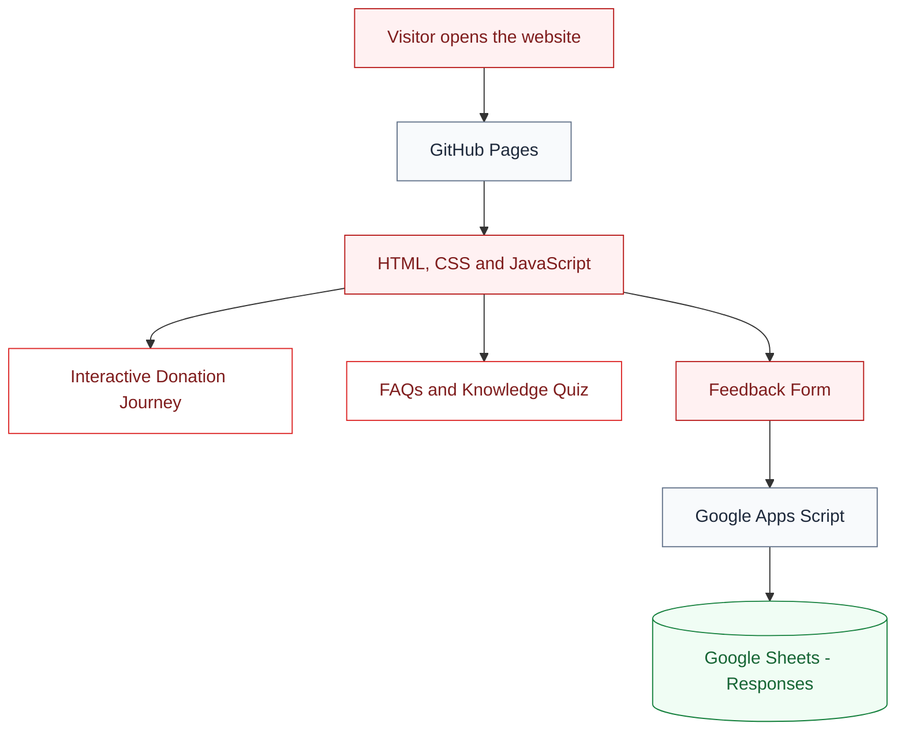

# 🩸 Drop by Drop

### Understand the journey. Spread awareness. Make information accessible.

An interactive blood donation awareness website developed as a
Community Engagement Project, based on publicly available information
from Dr. Hedgewar Blood Centre, Nagpur.

---

---

## 👀 Website Preview

Take a look at Drop by Drop in action.

🌐 **[Visit the Live Website →](https://01patilA04.github.io/blood-donation-cep/)**

---

---

## ⚙️ How It Works

Drop by Drop combines an interactive website with a cloud-based feedback system.

## 🚀 Getting Started

💻 Click to expand setup instructions

### Requirements

- A web browser such as Chrome.
- Visual Studio Code (recommended).
- The Live Server extension in VS Code (optional).

### Run the website locally

**1. Download the project**

Open the [GitHub repository](https://github.com/01patilA04/blood-donation-cep), click **Code → Download ZIP**, and extract the downloaded file.

**2. Open the project in VS Code**

Select **File → Open Folder** and choose the extracted project folder containing `index.html`, `css/` and `js/`.

**3. Start the website**

Right-click `index.html` and choose **Open with Live Server** if the extension is installed. Alternatively, open `index.html` directly in your browser.

**4. Explore the features**

Test the six-stage donation journey, FAQs, quiz, mobile navigation and feedback form.

**5. Verify feedback submission**

Submit a test response and check the `Responses` tab in the connected Google Sheet.

### Important notes

- Live Server is only for local development; it does not host the public website.
- The published website is hosted by GitHub Pages.
- An internet connection is needed for online resources and feedback submission.
- The feedback service must remain correctly configured and deployed for submissions to reach Google Sheets.

### The process in simple terms

- **GitHub Pages** delivers your website to visitors.
- **HTML, CSS and JavaScript** create the interface and its interactive features.
- **Google Apps Script** processes feedback submissions.
- **Google Sheets** stores the submitted responses for your team to review.

---

## 🌱 Why Drop by Drop?

For first-time donors, understanding the blood donation process can
feel unfamiliar. Drop by Drop presents the journey in a simple,
interactive format so visitors can explore each stage, learn through
FAQs and a short quiz, and share feedback about their experience.

**Our goal:** Make reliable blood donation information easier to explore.

---

---

## 📊 Feedback System

Drop by Drop includes a feedback form that allows visitors to share their experience and help the project team evaluate the usefulness of the website.

🔍 Explore how feedback collection works

### How it works

1. **Visitor input:** A visitor submits their website rating, visitor type, most helpful section, process clarity and optional suggestions.
2. **Form processing:** JavaScript validates the required fields and prepares the submitted data.
3. **Data transfer:** The website sends the feedback to a deployed Google Apps Script web app.
4. **Data storage:** Apps Script appends the submission, along with a timestamp, to the `Responses` sheet in Google Sheets.
5. **Review:** The project team checks the collected responses to understand visitor experiences and identify improvements.

### Technologies involved

- **JavaScript:** Collects the form values and sends the submission.
- **Google Apps Script:** Processes the request and writes the data.
- **Google Sheets:** Stores feedback centrally for the project team.

### Important limitations

The website uses `no-cors` mode, so the browser cannot read the service response to automatically confirm that a submission was saved. Successful submissions should be verified in Google Sheets.

The form is intended for website feedback, not medical records or sensitive personal information. Access to the response spreadsheet should remain restricted.

## 🧰 Technology Stack

Built with lightweight web technologies and Google services.

🔍 Explore the technologies used

| Technology | Purpose |
|---|---|
| HTML5 | Structures the website content and sections. |
| CSS3 | Handles styling, layout and responsive design. |
| JavaScript | Powers the interactive journey, quiz, navigation and feedback form. |
| Google Fonts | Provides the website typography. |
| GitHub | Stores the source code and tracks changes. |
| GitHub Pages | Hosts and publishes the website online. |
| Google Apps Script | Processes feedback submissions. |
| Google Sheets | Stores visitor feedback responses. |
| Visual Studio Code | Used to write and edit the code. |
| Live Server | Provides a local preview during development. |

